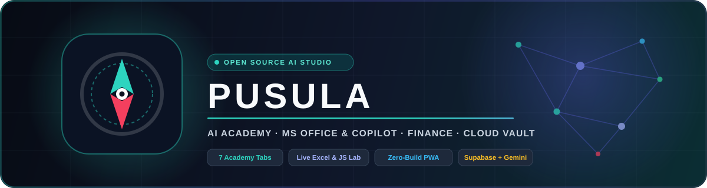
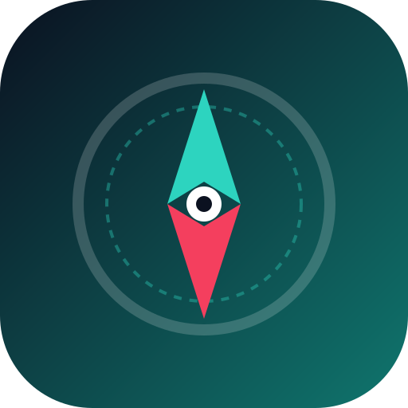
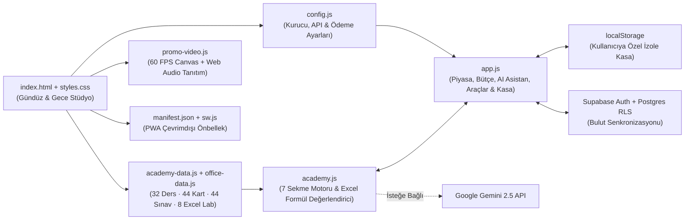

<div align="center">

<a href="https://pusula-web-opal.vercel.app">
  
</a>

<br /><br />



# Pusula — Yapay Zeka, MS Office Akademisi & Kişisel Yaşam Kokpiti

**Onlarca ayrı sekme ve dağınık uygulama yerine; yapay zeka eğitimini, sıfırdan uzman seviyesine Microsoft Office pratiğini, canlı piyasaları, bütçeyi, ofis şablonlarını ve bulut veri kasanızı tek bir yüksek hızlı açık kaynak arayüzde birleştiren yeni nesil çalışma merkezi.**

[](https://pusula-web-opal.vercel.app)
[](https://github.com/tayfunkaya49-star/pusula-web/pulls)
[](https://github.com/tayfunkaya49-star/pusula-web/stargazers)
[](https://github.com/tayfunkaya49-star/pusula-web/issues)

[](#sistem-mimarisi)
[](#öne-çıkan-özellikler)
[](#pusula-akademi-7-işlevsel-sekme)
[](#5-dakikada-yerel-kurulum)
[](#dosya-yapısı)

[Canlı Siteyi Aç](https://pusula-web-opal.vercel.app) · [Akademi Modülleri](#pusula-akademi-7-işlevsel-sekme) · [Sistem Mimarisi](#sistem-mimarisi) · [Kurulum](#5-dakikada-yerel-kurulum) · [Katkıda Bulun](#-açık-kaynak-katkı-rehberi)

</div>

---

## Neden Pusula?

Günlük iş akışında öğrenme, finans takibi, belge üretimi ve odaklanma için pek çok farklı sekme arasında gidip geliyoruz. **Pusula**, kurulum derdi olmayan (`Zero-Build`) modüler mimarisiyle:

- **Yapay Zeka & Yazılım Öğrenimi** için interaktif kod çalıştırma, Prompt analizi ve görsel simülatörler sunar,
- **Microsoft Office (Excel, Word, PowerPoint, Outlook)** için yalnızca okunan değil, **tarayıcı içinde canlı Excel formülü hesaplayan** pratikler ve AI Copilot taslakları üretir,
- **Gerçek Hayat Araçları** (canlı kur/altın/BTC, kredi & enflasyon simülatörü, bütçe/abonelik analizi, Pomodoro, canlı radyo/TV, T.C. mevzuat & dilekçe stüdyosu) ile öğrenmeyi günlük üretkenliğe bağlar.

> Projeyi faydalı bulduysanız sağ üstten **Star (⭐)** vererek daha fazla geliştiricinin keşfetmesine ve açık kaynak katkılarının büyümesine destek olabilirsiniz!

---

## Pusula Akademi: 7 İşlevsel Eğitim Sekmesi

Yapay Zeka, Yazılım ve Başlangıçtan Uzman seviyeye **Microsoft Office & AI Copilot** eğitimlerini XP, seviye ve seri (streak) sistemiyle birleştiren etkileşimli öğrenme motoru:

| # | Sekme | Yetkinlik & Kapsam | Öne Çıkan Etkileşim |
| :-: | :--- | :--- | :--- |
| **1** | **Müfredat & Dersler** | **8 Parkur · 32 Ders** (`Yapay Zeka & LLM`, `Python`, `Web & ES6+`, `Mimari/Git`, `MS Excel`, `MS Word`, `MS PowerPoint`, `Outlook & Teams`) | `Başlangıç` → `Orta` → `İleri` → `Uzman` seviye filtreleme, ders içi Mini Quiz, kişisel notlar ve **"AI Koçuna Sor"** butonu |
| **2** | **MS Office Pratik & AI Lab** | **8 Kademeli Excel Görevi** + **AI Office Copilot Stüdyosu** | Tarayıcı içinde gerçek Türkçe & İngilizce Excel formül motoru (`=TOPLA`, `=EĞER`, `=EĞERSAY`, `=ETOPLA`, `=DÜŞEYARA`, `=ÇAPRAZARA`, `=YUVARLA` / `SUM`, `IF`, `VLOOKUP`, `XLOOKUP`) + VBA/Word/PPT taslak üretici |
| **3** | **Canlı Kod & Prompt Lab** | **6 Test Edilebilir JS Görevi**, **3 HTML/CSS Şablonu**, **5 Katmanlı Prompt Stüdyosu** | Tarayıcı içi JavaScript sandbox + otomatik birim test doğrulayıcı, canlı `iframe` HTML/CSS stüdyosu ve 0-100 arası Prompt kalite puanlayıcı |
| **4** | **Akıllı Bilgi Kartları (3D)** | **44 Hazır Kart** (`24` Yazılım/AI + `20` MS Office) + Kişisel Kart Oluşturucu | 3D kart çevirme animasyonu, aktif tekrar puanlaması (`Zor / Hatırladım / Öğrendim`) ve kategori filtreleme |
| **5** | **Teknik Sınav & Mülakat** | **44 Çoktan Seçmeli Soru** (`Yapay Zeka`, `Python`, `Web & JS`, `Sistem & Git`, `Microsoft Office`) | Konu + Seviye (`Başlangıç`..`Uzman`) filtresi, `5 dk` süreli sınav sayacı, detaylı açıklamalar ve otomatik **Yanlış Defteri** |
| **6** | **AI & Algoritma Simülatörü** | **BPE Token Analizi**, **Softmax Temperature/Top-P**, **4 Sıralama Algoritması** | Metin/kod girdiğinde canlı token parçaları ve `8K/128K/1M` bağlam maliyeti; Quick, Bubble, Selection, Insertion Sort animasyonu |
| **7** | **Yol Haritası & Sertifika** | **8 Alan İlerleme Takibi**, Haftalık XP Hedefi & Chart.js Dağılımı | Yazdırılabilir **Başarı Sertifikası (PDF)**, Akademi ilerleme JSON yedeği alma ve geri yükleme |

---

## Pusula Pro, 60 Sn Tanıtım Videosu & Kişisel Veri Kasası

- **İnteraktif Sinematik Tanıtım Videosu (`promo-video.js`):** Modal içinde doğrudan tarayıcıda çalışan 60 FPS HTML5 Canvas + Web Audio API sahne oynatıcısı (5 tıklanabilir bölüm, zaman çizelgesi kontrolü ve `config.js` üzerinden harici MP4/YouTube bağlama desteği).
- **Kişisel Veri Kasası:** Misafir kullanımda bile yerel depolama; giriş yapan her kullanıcı için ise e-postaya göre izole edilen yerel kasa, **Supabase RLS bulut senkronizasyonu** ve tek tıkla tam JSON yedek indirip geri yükleme (`pusula-kisisel-veri-kasasi.json`).
- **Pusula Pro Ayrıcalıkları:**
  - `Uzman` seviye MS Office (`ÇAPRAZARA`, `VBA Makro`, `Copilot`) ders ve pratikleri
  - AI VBA Makro & Kurumsal Otomasyon Üreticisi
  - Bütçede **12 Aylık Net Birikim & En Yüksek Gider Tasarruf Analizörü**
  - **Yönetici CV Teması**, **AI CV Güçlendirme Koçu** ve filigransız PDF sertifika/CV
  - Sınırsız özel bilgi kartı ve `40Hz` Gamma / Alpha derin odak ses akışları

---

## Yaşam, Gündem, Finans & Üretkenlik Modülleri

<details>
<summary><b>Tüm Ek Modülleri Görüntülemek İçin Tıklayın (18+ Görünüm)</b></summary>

1. **Genel Bakış & Özelleştirme:** Sürükle/kapatılabilir kartlar, Akademi ilerleme kartı, hızlı bağlantılar, karalama defteri ve `Ctrl + K` global komut paleti.
2. **Pusula AI Asistan:** Yazılım, AI, Microsoft Office ve T.C. hukuk konularında akıllı yerel rehber + isteğe bağlı kendi **Gemini 2.5 Flash** API anahtarınızı bağlama desteği.
3. **Canlı Piyasalar & Portföy:** Otomatik yenilenen USD/TRY, EUR/TRY, Binance `PAXGUSDT` tabanlı Gram Altın proxy'si ve BTC canlı grafiği.
4. **Finansal Simülatörler:** Bileşik birikim, kredi amortisman tablosu (Excel `.xls` dışa aktarımlı) ve enflasyon alım gücü testi.
5. **Bütçe & Abonelikler:** Aylık net gelir, aktif/pasif abonelik tasarruf hesabı ve kategori dağılım barları.
6. **Günlük Plan, Pomodoro & Fikir Panosu:** Alışkanlık serileri, kategorili görev listesi, Pomodoro odak sayacı ve problem çözüm panosu.
7. **Ofis, Excel, Word, PDF & Hazır Şablonlar:** Tarayıcı içi Excel tablo editörü, `15` resmi/iş dilekçe şablonu ve canlı CV önizleyici.
8. **T.C. Kanun & Mevzuat Rehberi:** Anayasa, TBK (Kira), TKHK (Tüketici), İş Kanunu, TCK ve İİK özet maddeleri.
9. **Canlı Radyo, TV, Odak Sesleri & Oyunlar:** HLS destekli canlı TV (PiP), radyo/MP3 çalar, Web Audio sentezlenmiş odak/yağmur sesleri, Türkçe 5 harfli kelime oyunu, XOX, Hafıza ve Refleks testi.
10. **Araç Kutusu & Mobil PWA:** Canlı hava durumu, dünya saatleri, KDV hesaplayıcı, QR kod ve parola üreticisi, çevrimdışı Service Worker.

</details>

---

## Sistem Mimarisi

Pusula hiçbir paketleyici (`Webpack` / `Vite`) veya derleme adımı gerektirmez; doğrudan statik barındırmada ve `Live Server` üzerinde çalışır:



### Dosya Yapısı

```text
pusula-web/
├── README.md                        # Proje ana dokümantasyonu ve katkı rehberi
└── pusula-projesi/
    ├── index.html                   # Ana uygulama iskeleti (20 section, Gündüz/Gece UI)
    ├── styles.css                   # CSS değişkenleri, tema kuralları, 3D kart & tablo stilleri
    ├── config.js                    # Kurucu, Supabase, Gemini AI, video ve ödeme ayarları
    ├── academy-data.js              # Yazılım & Yapay Zeka müfredatı (4 parkur, 16 ders, JS görevleri)
    ├── office-data.js               # Microsoft Office & AI Copilot müfredatı (16 ders, 8 Excel pratiği)
    ├── promo-video.js               # 60 sn interaktif Canvas + Web Audio Pro tanıtım oynatıcısı
    ├── academy.js                   # 7 eğitim sekmesi ve canlı Türkçe/İngilizce Excel motoru
    ├── app.js                       # Çekirdek uygulama, canlı akışlar, veri kasası & AI asistan
    ├── manifest.json / sw.js        # PWA kurulum ve Service Worker önbellek katmanı
    ├── icon.svg / pusula-banner.svg # Vektör uygulama simgesi ve README AI bannerı
    ├── supabase-kurulum.sql         # RLS korumalı Supabase tablo ve tetikleyici şeması
    ├── vercel.json                  # Vercel barındırma ve yönlendirme yapılandırması
    ├── KURULUM-REHBERI.md           # Adım adım kurulum ve Vercel yayın rehberi
    └── UYELIK-VE-ODEME-REHBERI.md   # Supabase & ödeme bağlantısı entegrasyon notları
```

---

## 5 Dakikada Yerel Kurulum

Herhangi bir `npm install` veya build adımı yoktur:

1. **Depoyu indirin veya klonlayın:**
   ```bash
   git clone https://github.com/tayfunkaya49-star/pusula-web.git
   cd pusula-web/pusula-projesi
   ```
2. **Yerel bir statik sunucu ile açın** *(Service Worker ve yerel modüller için `file://` yerine HTTP önerilir)*:
   - **VS Code:** Klasörü açın → `index.html` üzerinde sağ tık → **Open with Live Server**
   - **Python ile:** `python -m http.server 4173` ardından `http://127.0.0.1:4173`
   - **Node ile:** `npx serve .`
3. **İsteğe Bağlı Bulut & Yapay Zeka Bağlantısı:**
   - [pusula-projesi/config.js](./pusula-projesi/config.js) içindeki `SUPABASE_URL`, `SUPABASE_ANON_KEY`, `GEMINI_API_KEY` ve ödeme bağlantılarını kendi hesabınıza göre güncelleyin.
   - Yeni veya mevcut Supabase projenizde [pusula-projesi/supabase-kurulum.sql](./pusula-projesi/supabase-kurulum.sql) dosyasını çalıştırın.

---

## 🤝 Açık Kaynak Katkı Rehberi

**Pusula topluluk katkılarıyla büyümeye açık bir projedir!** Yapay zeka mühendisleri, frontend geliştiricileri, Microsoft Office eğitmenleri ve arayüz tasarımcıları şu alanlarda doğrudan **Pull Request** açabilir veya fikir önerebilir:

### Katkı Verebileceğiniz Öncelikli Alanlar (Good First Issues)
- [ ] **Yeni Excel & Copilot Pratik Görevleri:** `office-data.js` içine `DÜŞEYARA`/`İNDİS-KAÇINCI`, Pivot veya tarih/metin fonksiyonları (`METNEÇEVİR`, `PARÇAAL`) desteği ve yeni pratik senaryolar eklemek
- [ ] **Genişletilmiş Python & RAG Laboratuvarı:** Pyodide (WebAssembly) ile tarayıcıda canlı Python çalıştırma sekmesi eklemek
- [ ] **Çoklu Dil Desteği (`i18n`):** Arayüz ve eğitim içeriklerine Türkçe/İngilizce anlık dil değiştirici kazandırmak
- [ ] **Yeni Tema & Erişilebilirlik:** Yüksek kontrast modu, ekstra klavye kısayolları ve ARIA ekran okuyucu iyileştirmeleri
- [ ] **Yeni Araçlar & Şablonlar:** `app.js` içine yeni T.C. resmi dilekçe şablonları veya kişisel verimlilik araçları eklemek

### Katkı Adımları
1. Sağ üstten depoyu **Fork** edin (`tayfunkaya49-star/pusula-web`).
2. Yeni bir dal oluşturun:
   ```bash
   git checkout -b feat/harika-ozellik
   ```
3. Değişikliklerinizi `pusula-projesi/` içinde yapın ve JavaScript sözdizimi kontrollerini çalıştırın:
   ```bash
   node --check pusula-projesi/config.js
   node --check pusula-projesi/academy-data.js
   node --check pusula-projesi/office-data.js
   node --check pusula-projesi/promo-video.js
   node --check pusula-projesi/academy.js
   node --check pusula-projesi/app.js
   ```
4. Değişikliklerinizi açıklayan bir mesajla commit edip **Pull Request** gönderin. Her türlü hata bildirimini ve geliştirme fikrini [Issues](https://github.com/tayfunkaya49-star/pusula-web/issues) sekmesinden paylaşabilirsiniz!

---

## Kurucu, İletişim & Site Kuralları

- **Kurucu & Proje Mimarı:** **Tayfun KAYA** ([@tayfunkaya49-star](https://github.com/tayfunkaya49-star))
- **İletişim E-postası:** [tayfunkaya49@gmail.com](mailto:tayfunkaya49@gmail.com)
- **Bilgilendirme & Yasal Not:** Pusula'da yer alan canlı piyasa göstergeleri, finans simülasyonları, yapay zeka yanıtları ve T.C. kanun özetleri yalnızca **eğitim ve genel bilgilendirme amaçlıdır**; yatırım veya hukuki danışmanlık tavsiyesi niteliği taşımaz. Kullanıcı verileri cihazda veya kullanıcının kendi Supabase bulut projesinde korunur ve üçüncü taraflarla paylaşılmaz.

---

<div align="center">

**Bu projeyi beğendiyseniz bir ⭐ Star bırakmayı ve geliştirmek için katkıda bulunmayı unutmayın!**

*Tayfun KAYA tarafından sevgi ve merakla geliştirildi.*

</div>
